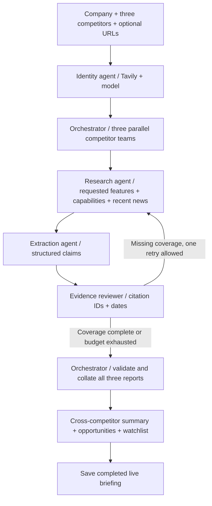

# Market research assistant

A live-only Streamlit application for cited competitor analysis. Enter your company, exactly three competitor names, optional official website URLs, buyer context and geography. Tavily gathers evidence and an OpenRouter model extracts core features, capabilities, positioning and dated news. LangGraph coordinates parallel research teams and compiles a structured briefing.

The application starts with an empty form. No demonstration data is bundled. Only completed live research is saved to the history library.

## Setup and launch

Python 3.11+ and uv are recommended:

```bash
cd "/Users/sathya/Projects/Market Research Assistant"
uv sync --frozen
uv run streamlit run streamlit_app.py
```

Open http://localhost:8501. Configure credentials in a local `.env` file (copy `.env.example`) or `.streamlit/secrets.toml`:

```dotenv
TAVILY_API_KEY=tvly-your-key
OPENROUTER_API_KEY=sk-or-v1-your-key
OPENROUTER_MODEL=openai/gpt-4.1-mini
```

API keys are read on the server. They are never rendered in page fields or included in saved briefing state. The app does not require a direct OpenAI key; the existing compatible LangChain transport sends model requests to `https://openrouter.ai/api/v1/chat/completions`. Choose an OpenRouter `provider/model` ID supporting JSON-schema structured outputs. Restart Streamlit after editing `.env`.

## Research and saved searches

1. Select **New research** in the sidebar.
2. Enter the focal company and three distinct competitor names. Add optional full HTTP(S) website URLs to guide identity resolution and constrain official feature and capability searches. Blank URLs are resolved automatically. Use **Core features to research** to specify the capabilities or workflows you want investigated.
3. Run live research. Review the briefing, competitor profiles, sources, gaps and activity log; download Markdown or JSON.
4. Select **Saved searches** to reopen any completed briefing. Filter by company or competitor, choose a dated search, and download its exports. The library survives app restarts and can be browsed without API credentials or new API calls. Use **Refresh history** to pick up newly completed searches.

A failed or interrupted attempt creates no saved briefing or persistent checkpoint. In-flight orchestration state stays in memory; rerun the request if it fails. Completed runs with missing evidence still report those gaps explicitly. Each successful run adds an independent history entry; rerunning the same company does not overwrite older research.

Completed exports are published together in a local directory:

```text
runs/<unique-search-id>/
  briefing.json    # scope, competitors, findings, citations, timestamps and activity
  briefing.md      # formatted report
```

Only valid completed live records appear in history. Keep the `runs/` directory to retain your searches. For hosted deployments, use a persistent disk for this directory. The application assumes a trusted local user; add authentication and per-user storage isolation before sharing a deployment.

## CLI

```bash
uv run python cli.py --company "Your company" \
  --competitors "Competitor A" "Competitor B" "Competitor C" \
  --competitor-urls "https://a.example.com" "https://b.example.com" "" \
  --context "Project management for product teams" \
  --feature-focus "Approvals, workflow configuration and integrations" --geography "United Kingdom"

uv run python cli.py --list
uv run python cli.py --show <32-character-search-id>
```

The list/show commands read saved files and make no search or model requests.

## Agent workflow



The orchestrator dispatches all three competitor teams concurrently using LangGraph `Send`. An explicit collation node waits for all teams, rejects missing or duplicate reports, and restores your competitor input order. Synthesis runs once after collation. Within each team, research, extraction and evidence review run sequentially because each consumes the previous step’s output. A concurrency test uses a three-party barrier to verify that the teams overlap and synthesis waits for every result.

The identity agent preserves your chosen competitors and order. Research uses supplied official domains when available. News requires a source publication date in the selected lookback window; retrieval time is separate. The reviewer removes claims without valid source IDs and news with unknown, conflicting, future or stale dates. Strategic interpretations are labeled as inferences.

A run makes 9 initial logical Tavily searches (three identity, three product, three news), with up to six targeted follow-ups. Each transient search error gets at most three HTTP attempts. The model runs 5–8 logical calls with bounded retries. Search and model API charges apply; advanced search may use multiple credits. Research context and public evidence are sent to the configured services.

Citations establish provenance structure, not semantic truth. Confidence values are model judgments. Review original sources, feature availability, supported integrations, limitations and vendor claims before making decisions. Missing evidence does not establish that a competitor lacks a feature.

## Tests

```bash
uv run pytest -q
```

Tests use synthetic doubles and mocked HTTP requests, without paid API calls. They cover live pipeline completion, saving and reloading, no saved files on failure, input validation, domain overrides, bounded follow-ups, evidence/date gates, provider request contracts, sanitized errors, empty initial UI, hidden credential controls and history browsing in a new session. Paid Tavily/OpenRouter end-to-end execution requires configured credentials.

## Files

- `streamlit_app.py`: research interface, saved-search library and downloads.
- `cli.py`: live research, history listing and reading.
- `research/orchestrator.py`: graph construction, delegation, joins, retry routing and synthesis.
- `research/agents/identity.py`: resolves the three supplied competitor identities.
- `research/agents/researcher.py`: Tavily feature, product and news research.
- `research/agents/extractor.py`: structured competitor findings.
- `research/agents/reviewer.py`: deterministic evidence review.
- `research/state.py`: shared graph and competitor-team state contracts.
- `research/evidence.py`: shared source deduplication.
- `research/graph.py`: compatibility imports for existing callers.
- `research/prompts/`: editable model instructions and search-query templates.
- `research/clients.py`: Tavily and OpenRouter clients.
- `research/models.py`: structured contracts and input validation.
- `research/quality.py`: citation and date checks.
- `research/runner.py`: live execution and completion-only persistence.
- `research/storage.py`: saved-search listing and loading.
- `research/formatting.py`: cited Markdown rendering.

References: [Tavily Search](https://docs.tavily.com/documentation/api-reference/endpoint/search), [LangGraph](https://docs.langchain.com/oss/python/langgraph/persistence), [OpenRouter structured outputs](https://openrouter.ai/docs/guides/features/structured-outputs).

## Configuring agent prompts

Edit the files below to change agent instructions without editing Python:

| File | Used by |
| --- | --- |
| `research/prompts/shared_system.md` | Shared evidence, trust and output instructions for every model call |
| `research/prompts/identity.md` | Identity agent: competitor resolution |
| `research/prompts/extraction.md` | Extraction agent: core features, positioning and news |
| `research/prompts/orchestrator.md` | Orchestrator: executive summary, opportunities and watchlist |
| `research/prompts/search_queries.json` | Identity and research agents: Tavily search query templates |

Prompt files are read on each invocation without caching; changes apply to subsequent calls. Finish edits before starting a run so every stage uses the intended configuration. Markdown prompts are plain instructions, not format-string templates. The JSON search templates use Python-style `{placeholder}` substitution: identity supports `name`, `domain`, `context` and `geography`; product supports `name`, `context`, `feature_focus` and `geography`; news supports `name` and `domain`. Keep the JSON valid. Missing/empty prompt files and invalid query placeholders produce configuration errors.

Briefings use one point per bullet, separate feature and positioning claims, numbered source links and explicit confidence labels. The interface and Markdown exports share the same bullet-list rendering functions. Updated rendering also applies when you reopen an older saved search; new research uses the shorter-claim prompt instructions.

The reviewer does not call a model, so it has no language-model prompt. Its implementation is in `research/agents/reviewer.py`, and its validation rules are in `research/quality.py`. The two-pass research budget and graph routing are configured in `research/orchestrator.py`. Output contracts remain in `research/models.py`: prompt edits cannot override the required three competitors, supported citations, publication-date gates or structured output schema.

Prompt files are included as package data when installing the project. No credentials belong in prompt files.

## Distinct report views

- **Briefing:** cross-competitor patterns, product implications, actionable hypotheses, validation steps and forward-looking signals. It contains no per-competitor highlight cards or repeated feature/positioning/news lists.
- **Competitor profiles:** detailed capabilities relevant to the requested feature focus, vendor positioning, dated news and evidence gaps for each company.

Searches no longer target pricing. The findings schema and profile renderer omit pricing, and extraction/synthesis prompts explicitly exclude commercial terms. Older saved records remain available with their original source provenance; the legacy source category is accepted for compatibility. Detailed pricing fields in older profiles are not displayed in the updated report.

Synthesis instructions require distinct information across views and sections. A deterministic check additionally removes exact copies of profile bullets (ignoring case and punctuation) and repeated briefing bullets. Semantic novelty still depends on model adherence and analyst review. The same check runs when rendering older saved searches, without new API calls.

## Human review and the acceptance target

After a completed briefing, open **Review this briefing**, check its sources and feature coverage, and record whether it is usable, your measured total task time in minutes, and any corrections. This saves `review.json` beside the completed search; it does not approve a roadmap, send messages or modify source websites. Automated research duration is also recorded separately from the PM’s total task time. Older saved searches remain compatible and may not have duration measurements.

The proposed acceptance target is a usable three-competitor briefing in under 10 minutes for at least 8 of 10 predefined research trials. This is a target, not a measured performance claim. Time each trial from starting the form through final PM review; a failure to complete counts as an unsuccessful trial in the benchmark, even though failed searches are intentionally absent from saved history. Agree before testing that a usable briefing covers all three selected competitors, cites its findings, addresses the requested features or explicitly states evidence gaps, separates analysis from profiles, and needs no material factual correction. Verify claims against their sources; source-ID validation alone is insufficient. The estimated two-hour manual baseline also needs a timed comparison.
